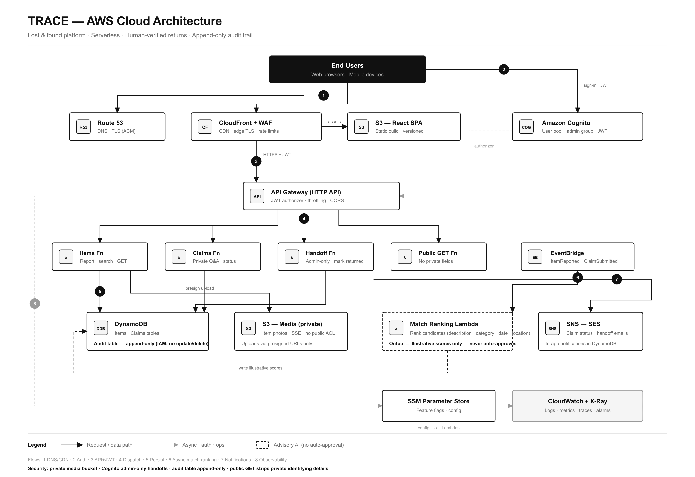

# TRACE

A modern, minimalist lost & found platform built with React. Report lost belongings, discover found items, submit ownership claims, verify ownership, and track the safe return of property through one transparent workflow.

> Lost something? Let's bring it back.

## Features

- **Editorial homepage** — full-screen hero with staggered entrance animations, recently found grid, four-step process timeline, smart matching preview, black trust & verification section, functional QR section, and final CTA.
- **Discover** — search, category/location/date filters, lost/found toggle, sort by newest or relevance, URL-persisted filter params, skeleton loading and empty/error states.
- **Item details** — photo gallery, description, status timeline, live QR code for the listing, claim CTA. Private identifying details are never rendered publicly.
- **Report an item** — guided 3-step form (basics → details → review) with drag-and-drop photo upload and previews, inline validation, lost/found toggle.
- **Claim & verification** — private ownership questions, claim statement, live claim status with review progress timeline.
- **User dashboard** — lost reports, found reports, my claims, possible matches (clearly labeled illustrative), notifications, status history.
- **Admin dashboard** — pending claim review queue, approve/decline with notes, handoff confirmation, item reports table, append-only audit log. AI never auto-approves ownership.
- **Microinteractions** — hover/focus/active states, toasts, modals with Escape + focus trap, animated status timelines, QR camera scanner gated behind explicit permission.
- **Motion** — Framer Motion fade-up reveals, staggered grids, image clip reveals, animated dividers and timeline connectors, subtle route transitions. All animations respect `prefers-reduced-motion`.

## Design system

| Token | Value |
| --- | --- |
| Background | `#FFFFFF` |
| Text | `#111111` |
| Secondary background | `#F5F5F5` |
| Borders | `#E5E5E5` |
| Type | Inter (Geist-like modern sans) |
| Icons | Lucide React (monochrome line) |

Black primary buttons, white secondary buttons with thin black borders, square/subtle corners, generous whitespace, Swiss-editorial typography.

## Architecture

Production AWS target architecture (serverless): Route 53 → CloudFront + WAF → S3 (SPA), Cognito auth, API Gateway → Lambda, DynamoDB (append-only audit), private S3 media, EventBridge match ranking (advisory only — humans approve), SNS/SES notifications.



Full service selection and data-flow write-up: [docs/architecture.md](docs/architecture.md). Regenerate the PNG with `npm run render:arch`.

## Tech stack

- React 18 + TypeScript + Vite
- Tailwind CSS
- Framer Motion
- React Router
- React Hook Form + Zod
- Lucide React
- `qrcode.react` (functional QR generation)
- `html5-qrcode` (camera scanning, permission-gated)

## Getting started

```bash
npm install
npm run dev
```

Build and preview:

```bash
npm run build
npm run preview
```

## Demo accounts

- **User** — any email address (e.g. `alex@example.com`). Sample data is pre-seeded for `alex@example.com` including a pending claim and notifications.
- **Admin** — `admin@trace.app` opens the review queue and audit log at `/admin`.

State is persisted to `localStorage`; clear site data to reset to the seeded demo.

## Routes

| Path | Page |
| --- | --- |
| `/` | Homepage |
| `/discover` | Search & filter listings |
| `/items/:id` | Item details + QR |
| `/report` | Multi-step report form |
| `/claim/:itemId` | Claim & verification |
| `/dashboard` | User dashboard |
| `/admin` | Admin review dashboard |
| `/signin` | Demo sign in |
| `/privacy`, `/terms` | Legal |

## Notes on AI matching

Similarity scores shown in Smart Matching and the dashboard are **illustrative UI indicators** for ranking candidates — clearly labeled as such. They are not probabilities of ownership, verified claims, or live model predictions. Every return requires human verification and a recorded handoff.

## License

MIT
