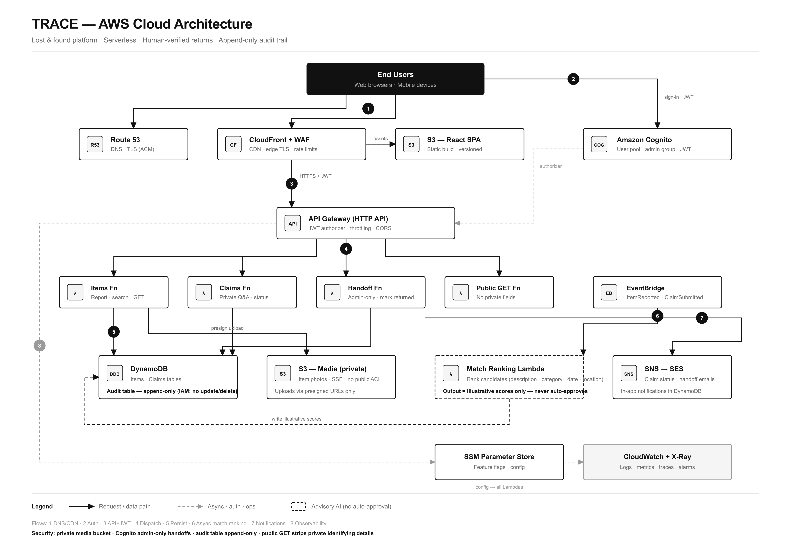

# TRACE — expanded AWS architecture reference



This older diagram describes an expanded alternative, not the initial deployment checklist. The current app is a static React SPA with local demo state; these services are not deployed yet. Use [aws-services.md](./aws-services.md) as the primary service plan and [aws-starter.md](./aws-starter.md) for implementation order. The first version uses Amplify Hosting instead of separately configuring website S3/CloudFront, and defers custom DNS, WAF, asynchronous matching, and application email.

The diagram's `SNS → SES` label is conceptual and omits a required integration: SNS does not directly invoke SES. A Lambda subscriber would be needed, or the application Lambda can call SES directly. The written flow below uses the latter. The product goal remains human verification and a recorded handoff for every return.

## Service selection

| Concern | Service | Rationale |
| --- | --- | --- |
| SPA hosting | **S3 + CloudFront** | Static React build behind a CDN; versioned deploys; cheap and cacheable |
| DNS / TLS | **Route 53 + ACM** | Apex domain, managed certificates |
| Edge protection | **AWS WAF** | Rate limiting and bot rules on CloudFront |
| Authentication | **Amazon Cognito** | User pool; `admin` group for reviewers; JWT passed to the API |
| API | **API Gateway (HTTP API)** | Lambda proxy integration; JWT authorizer; throttling |
| Compute | **Lambda** | Items, claims, handoff, public GET — event-driven, no servers |
| Core data | **DynamoDB** | Items and claims; single-digit-ms access; PK/SK access patterns |
| Audit trail | **DynamoDB (separate table)** | Append-only; IAM denies update/delete |
| Media | **S3 (private bucket)** | Item photos; SSE; block public access; presigned upload URLs only |
| Match ranking | **EventBridge → Lambda** | Async ranking on report/claim events; scores remain advisory |
| Notifications | **Lambda → SES** | Optional claim status and handoff emails; in-app notifications live in DynamoDB |
| Configuration | **SSM Parameter Store** | Feature flags and runtime config |
| Observability | **CloudWatch + X-Ray** | Logs, metrics, traces across API → Lambda → DynamoDB |

## How the services interact

### 1. Static delivery (flows 1, 3)

**Route 53** resolves the custom domain to **CloudFront**, where TLS terminates and optional **WAF** rules inspect requests. The React bundle comes from the private **S3 SPA** bucket via OAC. The SPA then calls the API over HTTPS with a Cognito access token. This hosting path is an alternative to Amplify Hosting.

### 2. Authentication (flow 2)

Users sign in through **Cognito**. Successful sign-in returns JWT access/ID tokens. Admin reviewers belong to the `admin` group; handoff and claim-decision APIs reject tokens without it.

### 3. API and compute (flow 4)

**API Gateway** validates the JWT (public item GETs may be unauthenticated) and routes to Lambdas:

- **Items Fn** — create/search lost & found reports; generates presigned S3 URLs for photo upload; public GET strips private identifying details
- **Claims Fn** — submit claims with private ownership Q&A; status transitions `pending → under_review → approved | rejected`
- **Handoff Fn** — admin-only; confirms return, marks item `returned`, appends audit events
- **Public GET Fn** — read-only item view for QR landing pages

### 4. Persistence (flow 5)

Lambdas write to **DynamoDB** (items, claims) and the **audit table**. Photo bytes go straight from the browser to the **media S3 bucket** using presigned URLs — the API never proxies file uploads.

### 5. Async match ranking (flow 6)

`ItemReported` and `ClaimSubmitted` events are emitted to **EventBridge**. The **Match Ranking Lambda** scores candidates on public description text, category, date, and location. These scores are ranking aids only — they never transition status. A human admin must approve.

### 6. Notifications (flow 7)

If application email is added, a **Lambda** handler calls **SES** for claim and handoff messages. SNS is optional fan-out and would require a subscriber such as Lambda to invoke SES. The first version only needs in-app notifications stored in DynamoDB and scoped to the user. Cognito verification/recovery email settings are configured separately.

### 7. Observability & config (flow 8)

Configure Lambda logs and HTTP API access logs in **CloudWatch**. Additional Lambda tracing and **SSM Parameter Store** configuration can be introduced when needed. Do not assume API Gateway HTTP APIs provide the same X-Ray tracing integration as REST APIs.

## Security controls (on the diagram)

- Media bucket: **block public access**, SSE, presigned uploads only
- Cognito **admin group** gates handoff and claim decisions
- Audit table: IAM policy **denies** `UpdateItem` / `DeleteItem`
- Public item responses **never** include private identifying details or claim answers
- Match Lambda output is advisory; **approval is always human**

## Regenerating the PNG

```bash
npm run render:arch   # docs/aws-architecture.svg → docs/aws-architecture.png
```
