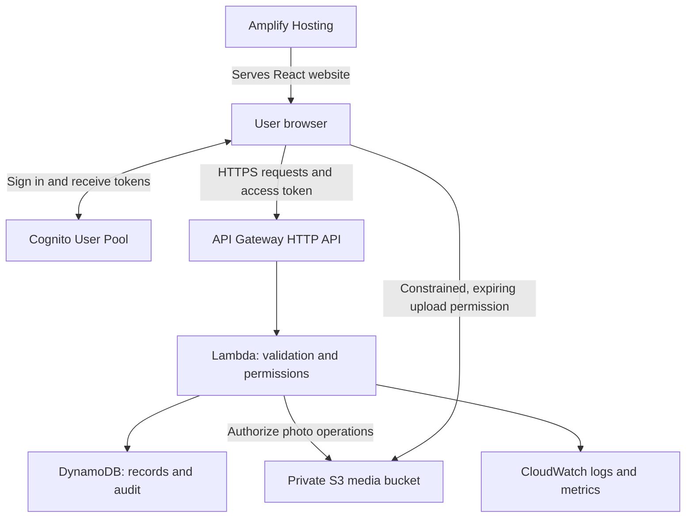

# TRACE AWS service inventory

Updated: 2026-11-04. Status: proposed first version; no AWS resources deployed.

TRACE currently stores demo data in the browser. This plan gives users real accounts, shared reports, protected claim answers, and persistent photos. Use six application services and three supporting services. The implementation roadmap is in [AGENTS.md](../AGENTS.md).

## Application services

| AWS service | Simple purpose | How TRACE will use it |
| --- | --- | --- |
| [Amplify Hosting](https://docs.aws.amazon.com/amplify/latest/userguide/welcome.html) | Put the website online | Build the React/Vite frontend from GitHub, publish `dist`, and provide HTTPS. Configure SPA rewrites for item and dashboard links. Use Hosting only; an Amplify-generated backend is not required. |
| [Cognito User Pools](https://docs.aws.amazon.com/cognito/latest/developerguide/cognito-user-pools.html) | Manage accounts and login | Verified sign-up, sign-in, password recovery, and an admin group. Replace the demo email login. Start by evaluating the Lite plan against the required sign-in experience. |
| [API Gateway HTTP API](https://docs.aws.amazon.com/apigateway/latest/developerguide/http-api-jwt-authorizer.html) | Provide the website's backend address | Route report, claim, review, and handoff requests to Lambda. Validate Cognito JWTs on protected routes. Public listing routes return only approved public fields. |
| [Lambda](https://docs.aws.amazon.com/lambda/latest/dg/welcome.html) | Run backend code when requested | Validate reports, check ownership/admin permissions, process claims and handoffs, calculate suggested matches, and create in-app notifications. |
| [DynamoDB](https://aws.amazon.com/dynamodb/pricing/) | Store application records | Reports, claims, user notifications, and audit events. Design indexes for the actual queries and use conditional/transactional writes to prevent two approved claimants. Propose a separate audit table with restricted write permissions. |
| [S3](https://docs.aws.amazon.com/AmazonS3/latest/userguide/PresignedUrlUploadObject.html) | Store item photos | A private media bucket with short-lived upload permissions issued by the backend. Store object references in DynamoDB, not image bytes. Define which listing photos can be viewed publicly through controlled delivery. |

These are planned responsibilities, not security features already implemented. API Gateway token checks must be followed by Lambda checks for the requested record and action. An admin group alone does not enforce those checks. Restricted audit permissions do not make the database inherently tamper-proof.

## Supporting services

| AWS service | Purpose for TRACE | Initial setup |
| --- | --- | --- |
| [IAM](https://docs.aws.amazon.com/IAM/latest/UserGuide/introduction.html) | Control access to AWS resources | Give each runtime/deployment role only the permissions it needs. Cognito manages TRACE users; IAM manages AWS permissions. Never put AWS credentials in the frontend. |
| [CloudWatch](https://docs.aws.amazon.com/AmazonCloudWatch/latest/monitoring/WhatIsCloudWatch.html) | Find errors and monitor the backend | Lambda logs, API access logs, error/throttle metrics, and selected alarms. Start with finite log retention, such as 14 days. Exclude tokens, claim answers, and private notes from logs. |
| [AWS Budgets](https://aws.amazon.com/aws-cost-management/aws-budgets/pricing/) | Warn about spending | Configure cost alerts before deploying. Notifications are not a hard spending cap. Monitor credits and actual usage as well. |

## Request flow

IAM controls service access; Budgets monitors costs. Browsers will not receive direct DynamoDB access. S3 upload signatures are temporary permissions, so the backend must constrain object keys, expiry, file type/size, and ownership, and verify uploads before attaching them to reports.

## Services to defer

| Service or option | Add only when needed |
| --- | --- |
| SES | Application emails such as claim decisions. Begin with in-app notifications; Cognito verification/password-recovery email configuration is a separate requirement. |
| EventBridge | Background matching or other asynchronous events when the request-based workflow is insufficient. |
| Route 53 and a custom domain | Use the Amplify default domain initially. Domain registration and DNS can add cost. |
| Separate CloudFront + website S3 setup | An alternative to Amplify Hosting, not another required hosting layer. The private photo bucket is still needed. |
| WAF, X-Ray, Parameter Store | Additional traffic protection, tracing, or configuration management when justified by actual needs and cost. |
| SageMaker, Bedrock, Rekognition | No requirement for the current matching algorithm. Evaluate text/image models only after measuring the baseline on labeled examples. |

Current TF-IDF text similarity and category/date/location scoring can run in Lambda. Scores suggest candidates; a human verifies ownership and records the return. We do not need EC2 servers or a continuously running model endpoint for this design.

## Free Tier and cost assumptions

Free Tier is account-dependent, not a promise that this system will always cost zero. Check the actual account plan, eligible services, remaining credits, expiry, and selected Region before provisioning. AWS describes the current program in its [Free Tier FAQ](https://aws.amazon.com/free/free-tier-faqs/); accounts created under earlier programs may differ.

- Amplify builds, hosting storage, and data transfer contribute to usage: [pricing](https://aws.amazon.com/amplify/pricing/).
- Cognito costs depend on feature plan, active users, and messaging; avoid SMS for the initial design: [pricing](https://aws.amazon.com/cognito/pricing/).
- API requests and Lambda execution consume usage allowances/credits: [API Gateway pricing](https://aws.amazon.com/api-gateway/pricing/), [Lambda pricing](https://aws.amazon.com/lambda/pricing/).
- Choose DynamoDB capacity mode deliberately. Provisioned read/write allowances do not make on-demand requests free: [pricing](https://aws.amazon.com/dynamodb/pricing/).
- Photo storage, requests, transfer, logs, and alarms need limits: [S3 pricing](https://aws.amazon.com/s3/pricing/), [CloudWatch pricing](https://aws.amazon.com/cloudwatch/pricing/).

Use one backend Region, compressed photos, paginated queries, bounded matching candidates, API throttles, and cleanup of abandoned uploads. Set a small budget threshold appropriate to the account. Record an estimate after expected users, photos, and requests are known.

## Implementation order

1. **Backend contracts first:** define public/private data, report relationships, statuses, and API operations; place demo access behind a service interface.
2. **Local backend logic:** implement validation, permission rules, claim approval, handoff consistency, and tests for two-user isolation and concurrent decisions.
3. **AWS account preparation:** verify plan/Region/costs and configure budget alerts and deployment access.
4. **Reproducible backend deployment:** add infrastructure configuration, then Cognito, DynamoDB, S3, API Gateway, Lambda, IAM roles, and CloudWatch. AWS SAM/CloudFormation is a candidate deployment tool; it has not been selected or implemented yet.
5. **Connect and host:** replace production localStorage operations with API calls, deploy through Amplify, and verify login, private data access, uploads, claims, and handoffs with two real accounts.

No browser demo data should be uploaded automatically. See [aws-starter.md](./aws-starter.md) for rollout notes and [architecture.md](./architecture.md) for the expanded alternative.
