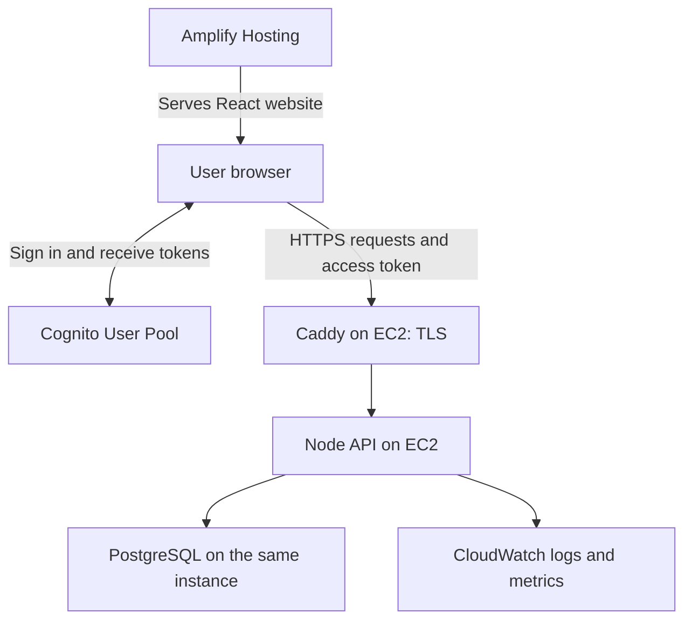

# TRACE AWS service inventory

Updated: 2026-11-08. Status: first-version plan. A Cognito user directory and the static Amplify Hosting frontend exist in Asia Pacific (Singapore). A local authenticated API and PostgreSQL repository are implemented but not deployed. The user selected one small EC2 instance for the API and PostgreSQL instead of API Gateway/Lambda/RDS; no EC2 resource exists yet. PostgreSQL was selected instead of the earlier DynamoDB proposal.

TRACE currently stores demo data in the browser. This plan gives users real accounts, shared reports, protected claim answers, and persistent photos. The first version uses four application services and three supporting services. The implementation roadmap is in [AGENTS.md](../AGENTS.md).

## Application services

| AWS service | Simple purpose | How TRACE will use it |
| --- | --- | --- |
| [Amplify Hosting](https://docs.aws.amazon.com/amplify/latest/userguide/welcome.html) | Put the website online | Build the React/Vite frontend from GitHub, publish `dist`, and provide HTTPS. Configure SPA rewrites for item and dashboard links. Use Hosting only; an Amplify-generated backend is not required. |
| [Cognito User Pools](https://docs.aws.amazon.com/cognito/latest/developerguide/cognito-user-pools.html) | Manage accounts and login | Verified sign-in and an `admin` group. The SPA obtains tokens through authorization code + PKCE; the API verifies them. Start by evaluating the Lite plan against the required sign-in experience. |
| [Amazon EC2](https://aws.amazon.com/ec2/pricing/) | Run the backend | One `t3.micro` AL2023 instance running Docker Compose: the Node API, PostgreSQL 18, a one-shot migration container, and Caddy for automatic HTTPS. The API validates requests, derives identity and roles from Cognito tokens, and enforces claim/review/handoff rules. |
| [S3](https://docs.aws.amazon.com/AmazonS3/latest/userguide/PresignedUrlUploadObject.html) | Store item photos | Deferred. Later: a private media bucket with short-lived upload permissions issued by the backend, object references in PostgreSQL, and controlled delivery. Photos stay out of the database. |

These are planned backend responsibilities. The manually created Cognito directory has an `admin` group and the SPA uses OIDC for sign-in, account navigation, and managed-login logout. Cloud mutations remain unavailable, and groups do not grant local demo privileges. The API derives the actor and `admin` role from a verified token, then checks the requested record and action. An admin group alone does not enforce those checks. Restricted audit permissions do not make the database inherently tamper-proof.

## Supporting services

| AWS service | Purpose for TRACE | Initial setup |
| --- | --- | --- |
| [IAM](https://docs.aws.amazon.com/IAM/latest/UserGuide/introduction.html) | Control access to AWS resources | Cognito manages TRACE users; IAM manages AWS permissions. Never put AWS credentials in the frontend. Use an instance role only if the API later needs AWS services. |
| [CloudWatch](https://docs.aws.amazon.com/AmazonCloudWatch/latest/monitoring/WhatIsCloudWatch.html) | Find errors and monitor the backend | Ship container logs with finite retention (for example 14 days) and add basic alarms. Exclude tokens, claim answers, and private notes from logs. |
| [AWS Budgets](https://aws.amazon.com/aws-cost-management/aws-budgets/pricing/) | Warn about spending | Configure cost alerts before deploying. Notifications are not a hard spending cap. Monitor credits and actual usage as well. |

## Request flow

IAM controls service access; Budgets monitors costs. Browsers never receive database access. When photo upload is added, upload signatures will be temporary permissions, so the backend must constrain object keys, expiry, file type/size, and ownership, and verify uploads before attaching them to reports.

## Services to defer

| Service or option | Add only when needed |
| --- | --- |
| SES | Application emails such as claim decisions. Begin with in-app notifications; Cognito verification/password-recovery email configuration is a separate requirement. |
| EventBridge | Background matching or other asynchronous events when the request-based workflow is insufficient. |
| Route 53 and a custom domain | Use the Amplify default domain initially. Domain registration and DNS can add cost. |
| Separate CloudFront + website S3 setup | An alternative to Amplify Hosting, not another required hosting layer. The private photo bucket is still needed. |
| WAF, X-Ray, Parameter Store | Additional traffic protection, tracing, or configuration management when justified by actual needs and cost. |
| SageMaker, Bedrock, Rekognition | No requirement for the current matching algorithm. Evaluate text/image models only after measuring the baseline on labeled examples. |

Current TF-IDF text similarity and category/date/location scoring runs inside the Node API using bounded candidate retrieval. Scores suggest candidates; a human verifies ownership and records the return.

## Free Tier and cost assumptions

Free Tier is account-dependent, not a promise that this system will always cost zero. Check the actual account plan, eligible services, remaining credits, expiry, and selected Region before provisioning. AWS describes the current program in its [Free Tier FAQ](https://aws.amazon.com/free/free-tier-faqs/); accounts created under earlier programs may differ.

- Amplify builds, hosting storage, and data transfer contribute to usage: [pricing](https://aws.amazon.com/amplify/pricing/).
- Cognito costs depend on feature plan, active users, and messaging; avoid SMS for the initial design: [pricing](https://aws.amazon.com/cognito/pricing/).
- [EC2](https://aws.amazon.com/ec2/pricing/) compute runs continuously while the instance is on. Check `t3.micro` hourly cost, [EBS](https://aws.amazon.com/ebs/pricing/) volume size, Elastic IP association, and data transfer under the account plan.
- Photo storage, requests, transfer, logs, and alarms need limits later: [S3 pricing](https://aws.amazon.com/s3/pricing/), [CloudWatch pricing](https://aws.amazon.com/cloudwatch/pricing/).

Use one backend Region, compressed photos, paginated queries, bounded matching candidates, and cleanup of abandoned uploads. Set a small budget threshold appropriate to the account. Record an estimate after expected users, photos, and requests are known.

## Implementation order

1. **Backend contracts first:** define public/private data, report relationships, statuses, and API operations; place demo access behind a service interface.
2. **Local backend logic:** implement validation, permission rules, claim approval, handoff consistency, and tests for two-user isolation and concurrent decisions. The repository and authenticated API now exist locally.
3. **AWS account preparation:** verify plan/Region/costs and configure budget alerts and deployment access.
4. **Backend deployment:** provision the EC2 instance, security group, and Elastic IP; deploy the Compose stack with Caddy HTTPS and apply the migration. Infrastructure-as-code is still to be chosen.
5. **Connect and host:** replace production localStorage operations with API calls, deploy through Amplify, and verify login, private data access, uploads, claims, and handoffs with two real accounts.

No browser demo data should be uploaded automatically. See [aws-starter.md](./aws-starter.md) for rollout notes and [architecture.md](./architecture.md) for the expanded alternative.
